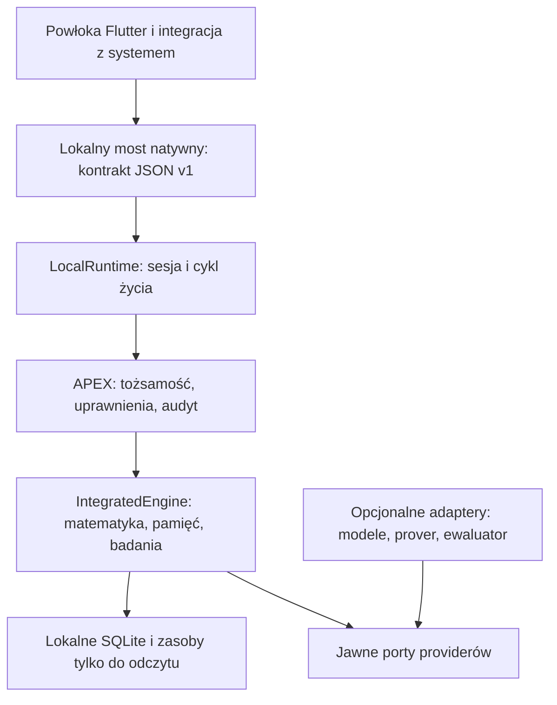

# Architektura docelowa: lokalny silnik desktop i mobile

Status: **BASELINE_ARCHITECTURE_V1**, zamrożony kontrakt do dalszej rozbudowy.
Ten dokument ma pierwszeństwo przed wymaganiami hostingu w dokumentach
historycznych. Decyzja właściciela: produkt lokalny; instalatory i binarki
powstaną dopiero po rozbudowie silnika. Nie jest to deklaracja ukończenia
aplikacji mobilnych, formalizacji matematyki ani gotowości wydania.

## 1. Granica produktu i decyzje wiążące

Jeden rdzeń Python, lokalne SQLite i zasoby tylko do odczytu. Aplikacja działa
bez serwera, konta chmurowego, Git, kontenera i internetu. Opcjonalny model,
research sieciowy lub ciężki prover jest adapterem z osobną konfiguracją;
jego brak wyłącza konkretną funkcję, nigdy uruchomienie rdzenia.

Docelowa wspólna powłoka UI: Flutter dla Windows, macOS, Linux, Android i iOS.
Rdzeń pozostaje osadzonym CPython, wywoływanym przez lokalny most natywny;
bez localhost HTTP i bez procesu serwera. Most i UI są zakresem późniejszej
implementacji. Kontrakt JSON v1 uniezależnia kod domenowy od UI i sposobu
osadzenia. CPython/cryptography/SQLite muszą przejść osobny build i testy na
każdym systemie przed wyborem wersji toolchain do dystrybucji. Dzisiejsze testy
profilu Android/iOS na Linuxie nie potwierdzają działania natywnego.



## 2. Podział odpowiedzialności i zależności

`architecture/boundaries.json` przypisuje **każdy** moduł do warstwy:

| Warstwa | Odpowiedzialność | Dozwolone zależności |
|---|---|---|
| domain | polityka, kontrakty providerów, reguły oceny, typy i algorytmy | domain |
| storage | indeksy, repozytoria SQLite, archiwum, rejestry | domain, storage |
| application | przypadki użycia, APEX, orkiestracja silnika | domain, storage, application |
| local_entry | publiczna sesja aplikacji lokalnej | domain, storage, application, local_entry |
| adapter | CLI, sieć, Docker, serwer opcjonalny, narzędzia badawcze | wszystkie powyższe |

Importy tworzą DAG. Rdzeń nie importuje adapterów, bibliotek sieciowych,
wykonawców procesów ani dynamicznych loaderów. Reguły statyczne i corpus
przeniesiono z `sandbox.py` do `evaluation_policy.py`; zgodne stare importy
pozostają dostępne w adapterze. `ports.py` definiuje ResearchProvider,
ProposalProvider i CandidateEvaluator. Konstruktor cyklu otrzymuje instancje
z zewnątrz, zamiast wybierać backend na podstawie zmiennych środowiskowych.

`python scripts/check_architecture.py` odrzuca nieprzypisany moduł, niedozwoloną
zależność, cykl i wskazane importy systemowe w rdzeniu. Jest to kontrola
regresji kodu first-party, nie sandbox dla złośliwych bibliotek lub obfuskacji.

## 3. Kontrakt aplikacji lokalnej v1

Implementacja referencyjna: `LocalConfig` i `LocalRuntime`.
Konfiguracja: jawny cel platformy, katalog zasobów, prywatny katalog danych,
opcjonalnie przypięty publiczny klucz właściciela. Brak szukania repozytorium,
sekretów w środowisku i automatycznego pobierania modeli.

Operacje cyklu życia: `status()`, `resume()`, `suspend()`.
Jedna instancja w procesie aplikacji obsługuje jeden katalog stanu. Powłoka
zapewnia pojedynczą instancję aplikacji; nie wolno współdzielić katalogu
między równoległymi silnikami. RLock szereguje żądania w jednej sesji.
Powłoka wywołuje silnik poza wątkiem UI. Zawieszenie czeka na ukończenie
bieżącej ograniczonej operacji i zapisuje PAUSED; wznowienie zachowuje
identyfikator APEX. Ubicie aplikacji nie uruchamia w tle kolejnych zadań.
`APEX.stop()` jest stanem terminalnym i nie służy do zwykłego zamknięcia UI.

Żądanie do `request()`:

```json
{"api_version":1,"request_id":"task-001","operation":"imandrax.math",
 "payload":{"operation":"gcd","arguments":{"a":84,"b":36}}}
```

Obecnie dostępne: `imandrax.math`, `imandrax.formal`, `dgm.history`.
Wynik: `api_version` i istniejący wynik dispatch APEX z hashem zdarzenia.
`request_id` jest unikalny w trwałej historii; duplikat jest odrzucany,
a nie wykonywany ponownie. Nieznana wersja, operacja, niedozwolony payload
lub operacja przy PAUSED jest odrzucana. Błędy kontraktu mają kod w ValueError,
błędy APEX w ApexError; przyszły most mapuje je na jawny błąd JSON, bez
przenoszenia tracebacku lub wyjątków przez ABI. Most waliduje JSON, rozmiary
wejścia i własność buforów; nie może wykonywać tekstu jako kodu.

Pamięć, cognition i event queue istnieją w IntegratedEngine, lecz nie uzyskują
nowych publicznych uprawnień przez samo dodanie tego interfejsu. Rozbudowa
wymaga jawnego kontraktu operacji i migracji manifestu APEX. Aktualny podpisywany
manifest nie został zmieniony. `rsi.proposals` pozostaje niewiązanym portem.

## 4. Dane, aktualizacje i odzyskiwanie

Zasoby aplikacji: `mathematics.sqlite3` i `repositories_public_701.tsv` w
katalogu tylko do odczytu. Profile aplikacji nie muszą zawierać `.git` ani
źródła `research/solver.py`. Większe modele i biblioteki będą osobnymi paczkami
zasobów z wersją, licencją, rozmiarem, hashem i zgodnością API. Instalacja
paczek nie może importować modułu Python ani modyfikować polityki uprawnień.

Dane zapisywalne: prywatny katalog aplikacji, rozłączny z zasobami, zawierający
bazy silnika i `local-layout.json` (`api_version=1`, `state_version=1`).
Nieznany lub starszy layout wymaga jawnej migracji; automatyczne przyjęcie
nieoznaczonych baz jest zabronione. Obecnie nie ma migratora ze starego layoutu.
Przyszła migracja: zamknięcie zadań → spójna kopia → transformacja kopii →
walidacja → atomowa podmiana → zachowanie poprzedniej wersji do rollbacku.

Istniejący memory_snapshot obsługuje pamięć, nie wszystkie bazy produktu.
Pełny eksport/import aplikacji musi objąć wszystkie repozytoria, wersję layoutu
i manifest; implementacja należy do rozbudowy. Lokalny audyt wykrywa określone
modyfikacje, ale administrator urządzenia może zmienić pliki. Nie nazywamy go
WORM. Eksport poza prywatny katalog wymaga świadomej akcji użytkownika.

Klucze prywatne: Keychain/Keystore/poświadczenia systemu przez przyszły adapter
platformowy. Rdzeń otrzymuje klucz publiczny i podpis, nie przechowuje prywatnego
klucza właściciela. Lokalne autoryzowane aktualizacje aplikacji wykonuje instalator
lub systemowy sklep, nigdy RSI. Nie ma auto-apply wygenerowanego kodu.

## 5. Różnice platform i ciężkie zadania

| Funkcja | Desktop | Android / iOS |
|---|---|---|
| Dokładna arytmetyka, odczyt źródeł, lokalne SQLite | rdzeń wspólny | rdzeń wspólny |
| Pamięć i reasoning | istniejące moduły, rozszerzany kontrakt | te same moduły, budżet powłoki |
| Wywoływanie wygenerowanego Python | tylko jawny izolowany adapter | domyślnie niedostępne |
| Docker, Git, zewnętrzny Lean | opcjonalne narzędzia laboratoryjne | brak wymagania i brak automatycznego fallbacku |
| Model lokalny | adapter z jawnym limitem RAM/CPU | adapter zgodny z polityką OS i limitem urządzenia |
| Zadania w tle | zgodnie z polityką OS | bez obietnicy ciągłej pracy; suspend/resume |
| Internet i synchronizacja | opcjonalny adapter, jawna konfiguracja | tak samo; bez obowiązkowego konta |

W modelu mobile kod wykonywalny dostarcza podpisana aplikacja, a nie zdalny
proposer. Research może przechowywać propozycje jako dane. Brak backendu daje
`UNAVAILABLE`, nigdy pozorny wynik ani automatyczne wykonanie na hoście.
Długie zadania przyszłych adapterów wymagają deadline, limitów pamięci,
checkpointu i kooperatywnego anulowania. Bieżące trzy operacje local API są
synchroniczne i ograniczone; nie deklarujemy już istniejącego async scheduler.

## 6. Dowody, bezpieczeństwo i bramki wydania

Rozróżniamy źródło, obliczenie, symulację, hipotezę i formalny dowód.
Symulacja nigdy nie awansuje do formalnego twierdzenia ani zgody na aktualizację.
Niezależność podpisu od proposera jest granicą uprawnień, nie wymogiem hostingu.
Historyczne HSM/WORM/multi-host/authority należą do opcjonalnego profilu
serwerowego; `release_admission.py` zachowuje swój rygorystyczny kontrakt dla
tego profilu i nie jest bramką uruchomienia lokalnej aplikacji.

Bramki desktop/mobile przed przyszłym wydaniem: natywne testy wszystkich celów,
licencje i SBOM, przypięte toolchains, podpisy platformowe, zgody prywatności,
instalacja/odinstalowanie, aktualizacja/rollback, migracja danych, crash recovery,
limity zasobów i działanie offline. Żadna z nich nie jest zaliczona samą
obecnością niniejszej architektury. Nie jest potrzebny trwały hosting produktu.

## 7. Zamknięcie architektury i warunki rozbudowy

Zamknięto decyzje o topologii lokalnej, kierunkach zależności, publicznym
kontrakcie, cyklu życia, własności danych, wersjonowaniu, rolach adapterów,
różnicach platform oraz rozdzieleniu zgody użytkownika od autonomicznych badań.
Wykonywalne bramki: klasyfikacja wszystkich modułów, brak cykli, brak zależności
rdzenia od Docker/sieci, testy local API bez sieci/procesów, trwała tożsamość,
odrzucenie przyszłego layoutu, duplikatu i niedostępnej capability.

Rozbudowa może dodawać funkcje wyłącznie w tych granicach. Zmiana topologii,
formatu danych, uprawnień lub kontraktu wymaga nowej decyzji architektonicznej,
migracji tam, gdzie potrzebna, i testu negatywnego. Zmiana pliku JSON z opisem
modułu nie przyznaje prawa wykonania. UI, most natywny, platformowe adaptery,
pełny recovery i instalatory są jawnie późniejszą implementacją, a nie ukrytymi
wymaganiami infrastruktury chmurowej.

Job CI budujący wheel/sdist został wstrzymany. Nadal działają testy źródeł,
architektury, izolacji i formalnych modułów. Nie powstają nowe instalatory ani
publikowane paczki dystrybucyjne; stare artefakty v1.3 pozostają historyczne.
